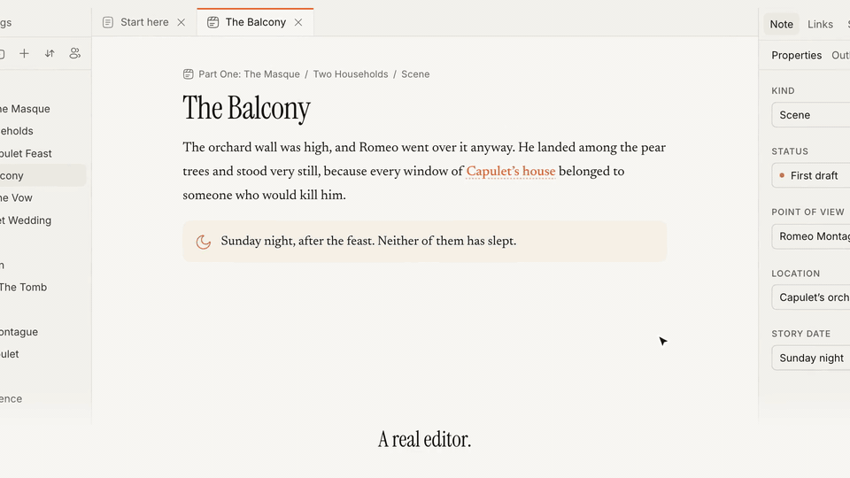
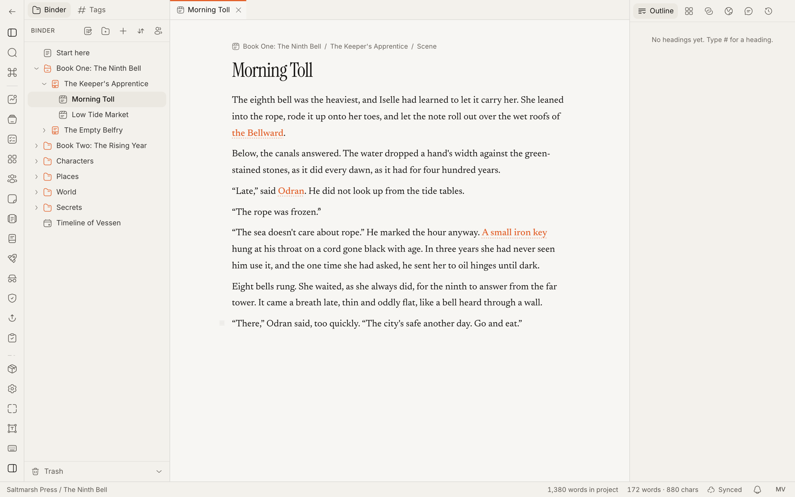
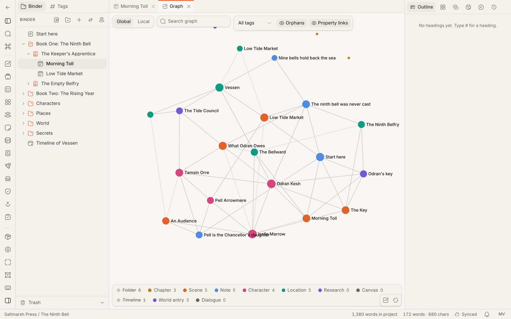
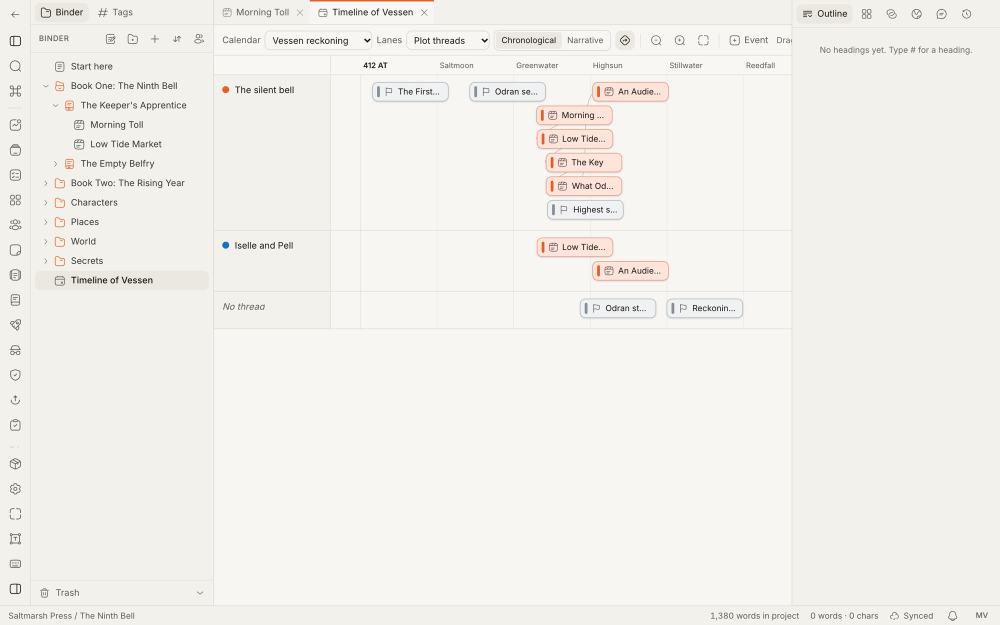

# Plotra

**Write your novel and build its world in one place.** Every scene, character and secret stays linked, your co-writers write alongside you, and Plotra keeps track of canon so you don't have to.



**[Try it free](https://app.plotra.ink/sign-up)** · **[Open the demo](https://app.plotra.ink/p/L3BNt7vjSUTtnRR_BlXGb406_TadQ2EX9WN6UcFU6IA)** · **[Self-host it](https://docs.plotra.ink/docs/self-hosting)** · **[Read the docs](https://docs.plotra.ink)** · **[Join the Discord](https://discord.gg/PxXr7Y4QrU)**

> **Status: early.** Built by one developer and tested mostly by them. Few people have used it yet, so keep your own copy of anything you care about.

## Why Plotra

Think of Obsidian built for stories, with more than one person in it. The manuscript and the world live in one linked project: scenes, characters, places, a timeline, a plot grid. You write together live, and three things no other writing tool has together keep the story straight:

- **The spoiler horizon.** Tag a note, or a single paragraph, with the book or episode that reveals it. Set "World as of Book 2" and the whole project shows only what the audience knows by then: the binder dims the rest, the editor veils unrevealed passages, and the graph, timeline, codex and exports are filtered. Write a recap, a fan wiki or the next book without spoiling it. For a game master, a wiki exported at the horizon is the player-safe version of the campaign.
- **Who knows what.** Record which character learns which secret, and in which scene. It catches "how does she know that?" before a reader does.
- **Continuity checks.** Plain rules, no AI: someone appears after their death, an age doesn't match the timeline, a character is in two places at once, a closed plot thread comes back, a payoff lands before its setup.

Try it on a sample project without an account: the fantasy novel [*The Ninth Bell*](https://app.plotra.ink/p/L3BNt7vjSUTtnRR_BlXGb406_TadQ2EX9WN6UcFU6IA) or [*Romeo and Juliet*](https://app.plotra.ink/p/s4QhRDiqd5TQsd23S1ls9Irr1T9zaIAMQXEFcbsahEo). Either can be copied into a workspace of your own.



| Graph | Timeline |
| --- | --- |
|  |  |

## Three ways to use it

| | What it is | Cost |
| --- | --- | --- |
| **[Plotra Cloud](https://app.plotra.ink)** | The hosted version. Sign up and start writing; share projects and write with others. | Free plan, or Pro at $10 a month per workspace |
| **Desktop app** (coming soon) | macOS, Windows and Linux. Use it as a window on Plotra Cloud, or keep a library in a folder on your computer: no account, no internet, Markdown copies and daily snapshots beside it. | Free |
| **[Self-hosted](https://docs.plotra.ink/docs/self-hosting)** | Your own server, with one `docker compose` command: the app, Postgres, the collab server and file storage. | Free, no limits you didn't set |

Whichever you pick, you can export everything: a whole project as a `.plotra` file that opens in any of the three, or as Markdown, DOCX, EPUB and Fountain.

## Features

**Writing and organising**

- A workspace like Obsidian's: a binder of folders, chapters, scenes and notes, tabs and split panes, an inspector, a command palette (`⌘P`), a quick switcher (`⌘O`) and hotkeys you can rebind.
- A rich-text editor with headings, lists, tables, callouts, images, a slash menu and a floating toolbar. Focus mode and typewriter scrolling.
- Wiki-links (`[[Note]]`, `[[Note#Heading]]`, `[[Note|alias]]`), embeds, hover previews, backlinks and unlinked mentions.
- Note types with your own fields, templates, tags and saved layouts.
- Presets that make it feel like Scrivener, Plottr, Google Docs, Obsidian, World Anvil or a distraction-free writer, and settings for nearly everything else.

**Seeing the story**

- Graph, codex, outline, corkboard, plot grid, relationship map, timeline with custom calendars, storyboard canvas, manuscript, and a paginated read and print view.

**Writing together**

- Live co-editing with named cursors. Edits made offline are kept and merged when you reconnect.
- Comments and replies, suggestions (track changes), and version history with named snapshots, a diff and restore.
- Workspaces with members, and project sharing by email as viewer, commenter or editor, including people outside the workspace.

**Story worlds**

- A world bible with your own entity types and fields, shared between projects.
- Canon status on notes and single passages, with retcon history.
- Releases (books, episodes, sessions), the release roadmap and the spoiler horizon.
- Who-knows-what, setups and payoffs, and continuity checks.

**Scripts and modules**

- Screenplay, stage play, comic and audio formats, with Fountain import and export.
- Modules for research and citations, editorial review, production breakdowns, branching dialogue and quests, localization, and publishing (EPUB, a series bible, a spoiler-safe wiki).

**AI, if you want it**

- An agent that can read, outline and edit with you, on your own API key (Anthropic, OpenAI, OpenRouter, any OpenAI-compatible URL) or a local model through Ollama. It runs with your access and no more, and is off until a workspace owner turns it on. What you write is never used to train AI.

**From outside the app**

- Personal API tokens, a REST API and an MCP server, so scripts and assistants such as Claude can work in your projects as you.
- Webhooks, and a project kept in a GitHub repository as Markdown, committed a few minutes after each change.
- Plugins that add commands, panels and export formats, run sandboxed in your browser. Write your own, or install them from the plugin store.

<details>
<summary><strong>How far testing has gone</strong></summary>

- The shell, editor and links: built, lightly click-tested.
- Collaboration, story tools, comments and versions, scripts and story worlds: built, checked in a headless browser. Live co-editing was checked with two browser sessions of one account typing into the same scene; it has not been tested with two different people, or with viewer and commenter roles.
- The API, webhooks, GitHub sync, plugins and the plugin store: built and covered by unit tests; plugins and the store haven't been run in a browser yet.
- The AI agent: built. One question was run end to end in a browser on a small local model (Ollama), including a tool call. Suggest and Auto, undo and long jobs have not been run by hand, and no hosted provider has been tried.
- The desktop app and its local libraries: built and covered by unit tests, not yet run as a packaged app.
- The site, the docs and the app are deployed: [plotra.ink](https://plotra.ink), [docs.plotra.ink](https://docs.plotra.ink) and [app.plotra.ink](https://app.plotra.ink), with the collab server at collab.plotra.ink.

</details>

## Pricing

Self-hosting is free, and so will the desktop app be. The hosted version is priced **per workspace, not per person**, and checkout isn't live yet.

| | Free | Pro |
| --- | --- | --- |
| Price | $0 | $10 a month, or $96 a year |
| Projects per workspace | 10 | Unlimited |
| Storage per workspace | 50 MB | 50 GB |
| One file | 10 MB | 100 MB |
| Workspace members | 3, counting the owner | 25 |
| Guests per shared project | 5 | 200 |
| Features and modules | All of them | All of them |
| AI agent | Your own key or a local model | The same, plus hosted AI: 1,500 credits a month |

- **No feature is locked behind Pro.** Pro is higher limits, more collaborators and hosted AI.
- **Going back to Free deletes nothing.** The workspace keeps its data and only can't grow past the Free limits. Export always works.
- **Payments** go through [Creem](https://creem.io) as merchant of record. Cancel any time from Workspace settings → Plan & billing; Pro runs to the end of the paid period.
- Hosted AI: one credit is 1,000 input tokens, output counts five times, and credits reset each billing period. Your own key still works on Pro and uses no credits.
- Smaller limits, the same on both plans: the latest 40 automatic versions are kept per note (named versions are always kept), and a person can send 40 invitations an hour. Self-hosters set or lift every limit with the `QUOTA_*` variables.

If Plotra is useful to you, you can also [sponsor it on GitHub](https://github.com/sponsors/ItzSudhan). Sponsoring buys nothing extra; it pays for the Free plan and the work on the software.

<details>
<summary><strong>What it costs to run</strong></summary>

The Free plan has to live on free tiers, because income arrives after people use the project, not before. Each Free limit maps to one of these.

| Service | Used for | Free tier | When it starts costing | About |
| --- | --- | --- | --- | --- |
| Vercel | App, site, docs | Hobby, non-commercial only | The day the Pro checkout goes live | Pro is about $20 a month |
| Cloudflare Workers | Collab server | 100k requests a day | Past that | $5 a month |
| Neon Postgres | Database | 0.5 GB | Past 0.5 GB | $5–20 a month, by usage |
| Cloudflare R2 | Files, version snapshots, backups | 10 GB, no egress fees | Past 10 GB | $0.015 per GB-month |
| SMTP (Resend here) | Invitations, digests | 3,000 emails a month | Past that | $20 a month |
| Sentry | Error tracking | Free tier | – | – |
| Domain (`plotra.ink`) | The site, app, docs and mail addresses | – | Already bought | A yearly renewal |
| AI models | Hosted AI on Pro only | – | With the first Pro workspace | By use, capped at 1,500 credits a month per workspace |
| Creem | Payments | – | On each payment | A fee out of each payment |

- Before checkout is live the cost is $0, or about $15 a year with a domain.
- Checkout brings the first fixed bill: Vercel's Hobby plan is non-commercial, so the hosted app then needs Vercel Pro or another host. Two Pro workspaces cover that, before Creem's fee.
- With every service on its first paid tier it is about $50–65 a month, plus hosted AI.
- On Free the project never pays for a model call: the agent runs on the user's own key or a local model.

Possible help with these bills, none applied for yet: the open-source programs of Neon, Vercel, Sentry and Cloudflare (credits, not cash), Open Source Collective as a fiscal host, and FLOSS/fund once there are real users. Until October 2026 the plan was sponsors alone, with no paid plans.

</details>

## Run it locally

You need [Bun](https://bun.sh) and a Postgres database. A free [Neon](https://neon.com) project works.

```bash
git clone https://github.com/ItzSudhan/plotra.git
cd plotra
bun install

cp apps/app/.env.example apps/app/.env.local
cp apps/collab/.dev.vars.example apps/collab/.dev.vars
```

Then fill in three values:

- `DATABASE_URL` in `apps/app/.env.local`: your Postgres connection string.
- `BETTER_AUTH_SECRET` in `apps/app/.env.local`: run `openssl rand -base64 32`.
- `COLLAB_SECRET`: another `openssl rand -base64 32`, with the same value in both `apps/app/.env.local` and `apps/collab/.dev.vars`.

```bash
bun run db:migrate
bun dev
```

| App | URL |
| --- | --- |
| The app (`apps/app`) | http://localhost:3000 |
| Site (`apps/web`) | http://localhost:3001 |
| Docs (`apps/docs`) | http://localhost:3002 |
| Collab server (`apps/collab`) | http://localhost:8787 |

Everything else in `.env.example` is optional. Without an SMTP server, invitation links are printed to the terminal. Without R2, version snapshots and attachments are stored in Postgres.

## Environment variables

Each app has its own env file; there is none at the root. The comments in [`apps/app/.env.example`](./apps/app/.env.example) say more about each one.

**`apps/app/.env.local`**

| Variable | Needed | What it does |
| --- | --- | --- |
| `DATABASE_URL` | Yes | Postgres connection string |
| `BETTER_AUTH_SECRET`, `BETTER_AUTH_URL` | Yes | Auth secret, and the app's own URL |
| `COLLAB_SECRET` | Yes | Shared with the collab server, for calls in both directions |
| `NEXT_PUBLIC_COLLAB_URL` | Yes | Where browsers reach the collab server |
| `COLLAB_INTERNAL_URL` | No | Where the server reaches the collab server, when that differs (Docker compose: `http://collab:8787`) |
| `GOOGLE_CLIENT_ID`, `GOOGLE_CLIENT_SECRET` | No | The Google sign-in button appears when both are set |
| `SMTP_URL`, `EMAIL_FROM` | No | Email over SMTP, through any mail service. Unset, emails are logged to the console |
| `CRON_SECRET` | No | Bearer for `/api/cron/digest`, the daily notification email |
| `S3_ENDPOINT`, `S3_BUCKET`, `S3_ACCESS_KEY_ID`, `S3_SECRET_ACCESS_KEY`, `S3_REGION` | No | File storage in any S3-compatible store (Cloudflare R2, MinIO, AWS S3). Unset, files go to Postgres |
| `DATABASE_DRIVER` | No | `pg` or `neon`. Unset, picked from the host |
| `AI_KEY_SECRET` | No | Encrypts users' own AI provider keys. Unset, bring-your-own-key is off |
| `AI_PROVIDER`, `AI_API_KEY`, `AI_BASE_URL`, `AI_MODEL_AGENT`, `AI_MODEL_FAST` | No | The server's own model: everyone's when self-hosting, Pro workspaces' (with credits) where plans are on |
| `AI_ALLOW_PRIVATE_URLS` | No | Lets AI base URLs point at localhost or a private network. Leave unset on a public server |
| `WEBHOOK_ALLOW_PRIVATE_URLS` | No | Lets webhooks post to localhost or a private network. Leave unset on a public server |
| `PLOTRA_NO_AI` | No | `1` takes AI out of the whole server: no workspace can switch it on, nobody can save a key |
| `CREEM_API_KEY`, `CREEM_WEBHOOK_SECRET`, `CREEM_PRODUCT_PRO_MONTHLY`, `CREEM_PRODUCT_PRO_YEARLY` | No | Paid plans. Without the key there are no plans and no billing code runs. Webhook: `<app>/api/billing/webhook` |
| `SENTRY_DSN` | No | Error tracking |
| `NEXT_PUBLIC_POSTHOG_KEY`, `NEXT_PUBLIC_POSTHOG_HOST` | No | Page views and clicks in PostHog, with the app's text masked, and a copy of the usage events, which are kept in Postgres either way |
| `NEXT_PUBLIC_SITE_URL` | No | The marketing site, for links back to it |

**`apps/web/.env.local`**: `NEXT_PUBLIC_APP_URL`, where the sign-in and sign-up links point, and the same two PostHog variables. Unset in a production build, the links point at the hosted version.

**`apps/docs/.env.local`**: the same two PostHog variables, optional.

**`apps/collab/.dev.vars`**: `COLLAB_SECRET` (the same value as the app's) and `AUTH_JWKS_URL` (`<app>/api/auth/jwks`).

## Self-hosting

The [self-hosting guide](https://docs.plotra.ink/docs/self-hosting) is in the docs (source: [`apps/docs/content/docs/(hosting)/self-hosting`](<./apps/docs/content/docs/(hosting)/self-hosting/index.mdx>)). It covers Docker (`docker/compose.yaml`: the app, Postgres, the collab server and MinIO) and running against Neon. It has not been tried by anyone but the developer; "Run it locally" above is the surer way to try Plotra.

## How it is built

### Tech stack

| Concern | Choice |
| --- | --- |
| Framework | Next.js 16 (App Router), React 19, TypeScript, Bun |
| Monorepo | Bun workspaces + Turborepo |
| Styling and UI | Tailwind CSS v4, shadcn/ui |
| Icons | Solar, through Iconify, loaded offline (`@plotra/icons`) |
| Editor | Plate.js |
| Real-time | Yjs with `@platejs/yjs`; `y-indexeddb` for the offline cache |
| Collab server | Cloudflare Workers + Durable Objects with `y-partyserver`, one Durable Object per document |
| Database | Postgres (Neon when hosted) with Drizzle ORM and row-level security |
| Auth | Better Auth: email and password, Google, magic link; its organization plugin for workspaces and its JWT plugin for collab tokens |
| File storage | Cloudflare R2, or any S3-compatible store |
| Email | SMTP (any mail service) |
| AI agent | Vercel AI SDK, on the user's own key (Anthropic, OpenAI, OpenRouter, any OpenAI-compatible URL) or a local model (Ollama) |
| Payments | Creem, as merchant of record |
| Panes and tabs | dockview |
| Command palette | cmdk |
| Graph | sigma.js + graphology |
| Canvas | React Flow (`@xyflow/react`) |
| Timeline | Custom, on dnd-kit |
| Docs site | Fumadocs |
| Hosting | Vercel (app, site, docs), Cloudflare (collab server) |

### Architecture

```
┌──────────────────────────┐        HTTPS         ┌──────────────────────┐
│  Next.js app (Vercel)    │ ───────────────────▶ │  Postgres (Neon)     │
│  - UI, Plate editor      │      Drizzle         │  users, workspaces,  │
│  - Better Auth           │                      │  projects, nodes,    │
│  - Server Actions / API  │                      │  comments, versions  │
│  - issues collab JWT     │                      └──────────────────────┘
└───────────┬──────────────┘
            │ WebSocket (Yjs sync + awareness), JWT
            ▼
┌──────────────────────────┐        ┌──────────────────────┐
│ Cloudflare Worker        │        │ Cloudflare R2        │
│  y-partyserver           │        │ snapshots, uploads,  │
│  1 Durable Object / doc  │        │ exports, backups     │
│  (SQLite-persisted Y.Doc)│        └──────────────────────┘
└──────────────────────────┘
```

1. A person signs in and opens a note.
2. The app checks their access with one server-side `can(action, project)` check and mints a short-lived JWT carrying their role.
3. The editor connects to the note's room on the collab server, which verifies the token. Viewer and commenter connections are read-only.
4. The Durable Object stores the Yjs document, and after a pause posts its text, word count and links back to the app, which indexes them in Postgres.

**What lives where.** Yjs holds what several people type into or drag at once: document text, storyboard canvases, branching dialogue. Postgres holds what gets queried: the binder tree, properties, links, relationships, plot threads, timeline events, comments, versions. Every text note is its own Yjs document.

**Access.** Workspace members are `owner`, `admin` or `member`. A project can be shared by email with anyone as `viewer`, `commenter` or `editor`, and can have one read-only link that opens without an account. There are no per-note permissions.

**The AI agent** has no permissions of its own. Its tools wrap the same server actions people use and run as the person who started the run. It is off until a workspace owner turns it on.

### Repository layout

```
apps/
  web/        the marketing site (Next.js)
  app/        the product (Next.js)
  collab/     the collab server (Cloudflare Worker)
  docs/       the docs site (Fumadocs)
  desktop/    the desktop app (Electron), cloud window or local library
packages/
  ui/         @plotra/ui: shadcn components and the Tailwind theme
  icons/      @plotra/icons: the Solar icon wrapper
  db/         @plotra/db: Drizzle schema, migrations, client
  auth/       @plotra/auth: Better Auth config and JWT helpers
  config/     shared tsconfig and ESLint config
docker/       compose file and Dockerfiles for self-hosting
scripts/      backup.ts, check-licenses.ts
```

- Internal packages are consumed as TypeScript source, so there is no separate build step.
- Apps import only from `packages/*`, never from each other.
- `turbo run dev|build|lint|typecheck` from the root.
- Auth lives only in `apps/app`; the site just links to sign-in and sign-up.

## Contributing

Issues, ideas and pull requests are welcome. Read [CONTRIBUTING.md](./CONTRIBUTING.md) first: it covers setup, how the code is organised, and the few rules that matter (the main one: talk before you add a database migration). For anything larger than a small fix, open an issue before you start.

- [Discord](https://discord.gg/PxXr7Y4QrU): questions, ideas, and talking a change through before you build it
- [Code of conduct](./CODE_OF_CONDUCT.md)
- [Reporting a security problem](./SECURITY.md)

## Licence

Plotra is licensed under the [GNU Affero General Public License v3.0](./LICENSE) (AGPL-3.0-or-later). If you run a modified version as a network service, you must make your source code available to its users.

Icons are [Solar](https://www.figma.com/community/file/1166831539721848736) by 480 Design, used under [CC BY 4.0](https://creativecommons.org/licenses/by/4.0/). The licences of the other dependencies are checked by `bun scripts/check-licenses.ts`.
